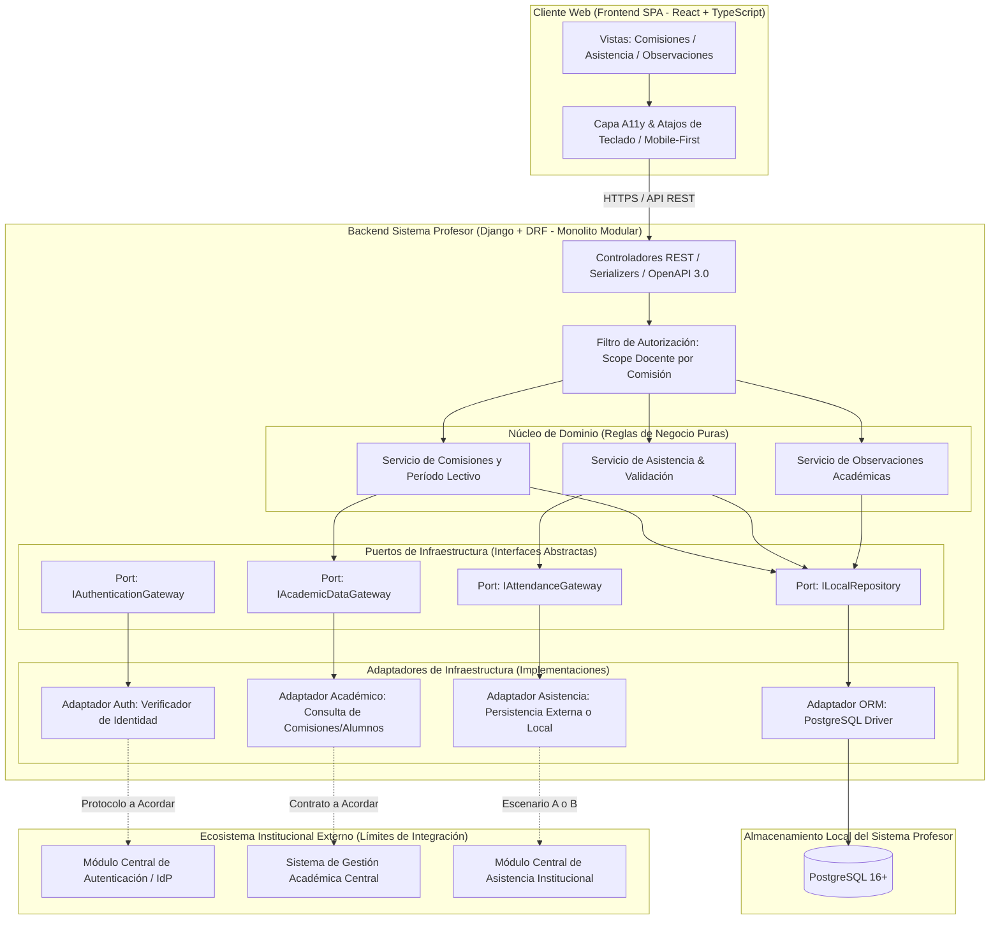

# Propuesta y Especificación Arquitectónica — Sistema Profesor

**Estado:** Base técnica inicializada y verificada (Bloque 1)  
**Proyecto:** Sistema de Gestión Académica — Sistema Profesor  
**Documentos de referencia:** [spec.md](file:///c:/Users/Nicolas/Desktop/tarea/spec.md) | [ARCHITECTURE_OPTIONS.md](file:///c:/Users/Nicolas/Desktop/tarea/docs/architecture/ARCHITECTURE_OPTIONS.md) | [DECISIONS.md](file:///c:/Users/Nicolas/Desktop/tarea/docs/DECISIONS.md) | [SPEC-002](file:///c:/Users/Nicolas/Desktop/tarea/docs/specs/SPEC-002-modelo-dominio.md)

---

## 1. Visión General y Clasificación de Decisiones

El **Sistema Profesor** provee al cuerpo docente herramientas ágiles y accesibles para consultar sus comisiones, verificar la nómina de alumnos, asentar la asistencia en el aula y registrar observaciones académicas de seguimiento.

Para evitar ambigüedades técnicas, todos los aspectos arquitectónicos se clasifican bajo la siguiente taxonomía:
- **Principio arquitectónico recomendado:** Directriz de diseño adoptada para guiar la estructura técnica (ej. desacoplamiento, Zero Trust, accesibilidad).
- **Decisión propuesta pendiente de aprobación:** Recomendación técnica concreta del equipo que aguarda visto bueno del responsable (ej. stacks, puertos y adaptadores).
- **Capacidad opcional futura:** Funcionalidad o patrón avanzado no obligatorio para el MVP inicial, sujeto a que surjan requisitos específicos (ej. modo offline, Outbox en segundo plano).
- **Decisión que depende de acuerdos institucionales:** Definición condicionada a contratos, protocolos o políticas de otros módulos del Sistema de Gestión Académica (ej. protocolo de autenticación, fuente oficial de asistencia).

---

## 2. Alternativas Arquitectónicas y Recomendación

En la **Tarea 1.1** se evaluaron formalmente tres alternativas arquitectónicas (ver comparativa exhaustiva en [ARCHITECTURE_OPTIONS.md](file:///c:/Users/Nicolas/Desktop/tarea/docs/architecture/ARCHITECTURE_OPTIONS.md)):
- **Opción A (Monolito Modular Global del SGA):** No recomendable por inviabilidad organizativa actual (requiere unificar deploys y repositorios con equipos externos de otros módulos).
- **Opción B (Microservicios / APIs HTTP Distribuidas Síncronas puras):** No recomendable por alto riesgo de acoplamiento a servicios sin contratos y vulnerabilidad a caídas de red en el aula.
- **Opción C (Arquitectura Híbrida Desacoplada con Puertos y Adaptadores):** *Decisión propuesta pendiente de aprobación*.
  - El Sistema Profesor se concibe como una aplicación web autónoma (Frontend SPA accesible + Backend modular) que utiliza abstracciones internas (*Ports*) para desacoplar el dominio docente de los servicios institucionales que aún no tienen contratos definidos.

---

## 3. Diagrama Conceptual de Componentes



---

## 4. Persistencia e Integración de Asistencias: Análisis de Escenarios

La propiedad definitiva de los datos de asistencia es una **decisión que depende de acuerdos institucionales**. Para no bloquear el diseño del Sistema Profesor, se documentan los dos escenarios posibles que el puerto `IAttendanceGateway` puede soportar:

### Escenario A: Persistencia Oficial Delegada en el Módulo Central de Asistencia
El Módulo Central de Asistencia es la única fuente oficial de la verdad (*Single Source of Truth*). El Sistema Profesor actúa como una interfaz de captura que remite las asistencias y consulta los historiales mediante llamadas a la API de dicho módulo.

- **Responsabilidades:**
  - Sistema Profesor: Validar la entrada docente en el aula, verificar que el profesor tenga asignada la comisión y despachar la toma de asistencia al servicio central mediante su adaptador HTTP.
  - Módulo Central: Persistir la asistencia oficial, calcular estadísticas de inasistencias y exponer el historial consolidado.
- **Ventajas:** Cero duplicación de datos; consistencia inmediata con las reglas y reportes institucionales; menor superficie de datos que mantener localmente.
- **Riesgos:** Fuerte acoplamiento de disponibilidad (si el servicio central no responde o la red del aula falla, no se puede completar la toma de asistencia síncrona sin un mecanismo de reintentos).
- **Requisitos:** Disponibilidad de endpoints con baja latencia para registro en lote y consulta de historial; definición de contratos de error claros y tiempos de respuesta compatibles con el aula.

### Escenario B: Persistencia Local en el Sistema Profesor con Sincronización Institucional
El Sistema Profesor registra y almacena transaccionalmente las asistencias en su base de datos local (PostgreSQL) y asume la responsabilidad de sincronizar los registros con el sistema institucional.

- **Responsabilidades:**
  - Sistema Profesor: Almacenar los registros de asistencia de sus comisiones, garantizar unicidad transaccional local, servir el historial al docente y ejecutar la sincronización hacia el sistema institucional.
  - Módulo Central: Recibir y consolidar las asistencias enviadas por el Sistema Profesor.
- **Ventajas:** Alta resiliencia operativa en el aula; el docente nunca sufre bloqueos ante caídas del servicio central; lecturas de historial ultra rápidas.
- **Riesgos:** Riesgo de divergencia de datos si una asistencia se rectifica en un sistema y no en el otro; complejidad de sincronización y resolución de conflictos.
- **Requisitos:** Acuerdo institucional que autorice la persistencia local de asistencia y defina el mecanismo de sincronización (lotes, eventos o APIs de sincronización).

### Clasificación de Capacidades Avanzadas de Asistencia
- **Patrón Outbox / Sincronización asíncrona:** Se clasifica formalmente como **Capacidad opcional futura**. Si en el MVP inicial se adopta el Escenario A con un backend online estándar o el Escenario B con sincronización síncrona directa, no se implementará el patrón Outbox para no sobrecargar de complejidad el proyecto. Solo se incorporará si los requisitos de integración institucional o conectividad deficiente en el aula lo exigen formalmente.
- **Soporte Offline en Frontend:** Se clasifica como **Capacidad opcional futura**. En el MVP se asume conectividad web estándar durante la jornada docente.

---

## 5. Idempotencia, Fechas e Instancias de Clase

La gestión de asistencias en el aula presenta situaciones particulares que requieren una distinción clara antes de definir restricciones físicas:

### 5.1. Distinción entre Fecha e Instancia de Clase
Una simple fecha de calendario (`YYYY-MM-DD`) **no es suficiente** para identificar de forma unívoca una clase de una comisión:
- **Múltiples clases en un mismo día:** Una comisión puede dictar un bloque teórico por la mañana y un bloque práctico o de laboratorio por la tarde.
- **Doble turno o clases extraordinarias:** Pueden programarse recuperaciones de clases en la misma jornada.
- **Concepto de Instancia de Clase:** Cada evento de toma de asistencia debe asociarse a una *Instancia de Clase* (definida por identificador de clase, bloque horario o turno dentro de la fecha), evitando colisiones erróneas.

### 5.2. Tratamiento de Escenarios Operativos

1. **Reintentos de una misma operación:** Si por inestabilidad de red el cliente reenvía la petición HTTP de toma de asistencia, la operación debe ser idempotente: no debe generar registros duplicados ni arrojar error de duplicidad, sino confirmar el estado actual.
2. **Envío repetido de una lista de asistencia:** Si el docente pulsa "Guardar" dos veces consecutivas, el backend debe reconocer que se trata de la misma instancia y retornar confirmación sin duplicar filas.
3. **Modificación de un registro existente:** Si la política institucional autoriza la rectificación en el día, el reenvío de un estado distinto para un alumno en la misma instancia de clase debe tratarse como una actualización (*update/upsert*) controlada con auditoría de usuario y hora, no como un nuevo registro.
4. **Dos clases de una comisión en el mismo día:** Al contemplar la instancia de clase (o bloque horario), el sistema permite tomar asistencia de forma independiente para el bloque de la mañana y para el bloque de la tarde sin conflictos.

> **Importante:** Las restricciones físicas de base de datos (claves primarias, índices únicos o compuestos) **no se fijan en esta etapa**. Las reglas definitivas de unicidad y ciclo de vida de la clase se especificarán conceptualmente durante la **Etapa 3: Modelo de Dominio y Reglas de Negocio**.

---

## 6. Autenticación y Autorización de Datos Académicos

### 6.1. Separación Conceptual de Niveles de Seguridad

Para garantizar un diseño robusto y desacoplado, se distinguen cuatro conceptos independientes:

```text
[1. Identidad Autenticada]
  │   ¿Quién es el usuario? (Verificación de credenciales en el proveedor de identidad)
  ▼
[2. Rol del Usuario]
  │   ¿Qué tipo de usuario es en el sistema? (ej. DOCENTE, ADMINISTRADOR, ALUMNO)
  ▼
[3. Asignación Académica]
  │   ¿Tiene este profesor un vínculo académico formal con la Comisión X en el período activo?
  ▼
[4. Autorización sobre el Recurso]
      ¿Tiene permiso este docente para ver la nómina, asentar asistencia o registrar una observación en la Comisión X?
```

- **Protocolo de Autenticación:** Se mantiene como **Decisión que depende de acuerdos institucionales**. No se asume JWT, OAuth2 u OIDC como solución definitiva. La capa de negocio interactúa exclusivamente con el puerto `IAuthenticationGateway`, el cual provee la identidad y el rol independientemente del transporte (tokens o cookies).
- **Autorización Docente:** Es un **Principio arquitectónico recomendado (Zero Trust)**. Ningún docente puede acceder a comisiones ajenas, garantizando aislamiento estricto de datos de los alumnos.

### 6.2. Datos Maestros Académicos (Alumnos, Comisiones, Materias)
- **Fuente Oficial:** El Sistema Central de Gestión Académica (SGA) es la fuente oficial indiscutida de los datos de alumnos, comisiones, materias y asignaciones docentes.
- **Riesgo de Duplicación Inconsistente:** El Sistema Profesor no debe permitir la modificación de nombres de alumnos, materias o cupos de comisión.
- **Estrategia:** El Sistema Profesor operará con acceso de **solo lectura** sobre estos datos a través de `IAcademicDataGateway`. Si se implementa almacenamiento local de soporte, este operará como una réplica de lectura o caché controlada, supeditada a las directrices de integración que defina el SGA.

---

## 7. Accesibilidad y Usabilidad en el Aula

Como **Principio arquitectónico recomendado**, la experiencia de usuario debe priorizar la inclusión, simplicidad y reducción de carga cognitiva:
- **Accesibilidad universal (WCAG 2.1 AA):** Todo control de la interfaz (botones de asistencia, selector de comisiones) debe ser operable íntegramente mediante teclado, con contraste visual superior a 4.5:1 y compatibilidad semántica con lectores de pantalla.
- **Diseño Mobile-First adaptado:** La toma de asistencia suele ocurrir de pie, en movimiento o desde dispositivos móviles de pantalla reducida. Los controles deben contar con áreas de toque amplias (mínimo 44x44 px) y confirmaciones visuales claras.
- **Minimización de fricción:** Evitar pantallas complejas con información prescindible; focalizar la vista en la nómina de alumnos y los estados de asistencia (`presente`, `ausente`, `tarde`).

---

## 8. Transición a la Etapa 3

Con la resolución de las ambigüedades arquitectónicas y la clarificación de escenarios, el proyecto queda formalmente preparado para avanzar a la **Etapa 3: Modelo de Dominio y Reglas de Negocio**.

- **Próximo Entregable Previsto:** [`docs/specs/SPEC-002-modelo-dominio.md`](file:///c:/Users/Nicolas/Desktop/tarea/docs/specs/SPEC-002-modelo-dominio.md).
- **Alcance de la Etapa 3:**
  - Definición conceptual de entidades (`Profesor`, `Comisión`, `Materia`, `Alumno`, `InstanciaClase`, `Asistencia`, `ObservaciónAcadémica`).
  - Definición de relaciones y cardinalidades.
  - Invariantes y reglas de negocio formales (ciclo de vida de la asistencia, período lectivo, validaciones de observaciones).
  - **Exclusiones estrictas:** No se definirán tablas físicas de base de datos, tipos de columnas SQL, migraciones de Django ni endpoints definitivos de API.
