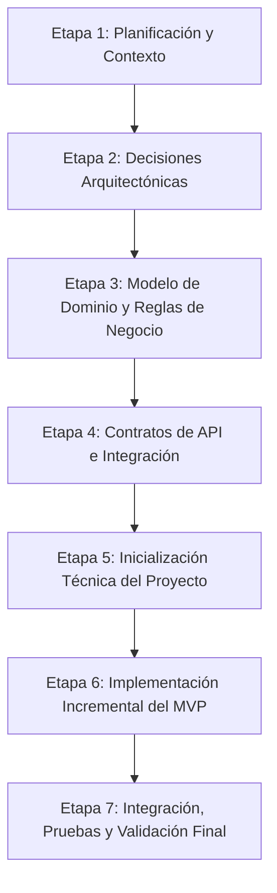

# Hoja de Ruta de Desarrollo (ROADMAP) — Sistema Profesor

**Proyecto:** Sistema de Gestión Académica — Sistema Profesor  
**Enfoque:** Desarrollo controlado por etapas, guiado por contratos, accesibilidad y seguridad.

---

## Estructura General de las Etapas

---

## Detalle de Etapas

### Etapa 1 — Planificación y Contexto (Estado: En curso / Finalizando Tarea 0.1)

- **Objetivo:** Inspeccionar el estado inicial del espacio de trabajo, analizar la especificación preliminar (`spec.md`), identificar riesgos/ambigüedades y formalizar la base documental del proyecto.
- **Entregables:**
  - Base documental en `docs/`: `ARCHITECTURE.md`, `DECISIONS.md`, `PROGRESS.md`, `ROADMAP.md`, `docs/specs/`.
  - Informe de inspección con análisis de contradicciones y decisiones pendientes.
- **Dependencias:** Ninguna (punto de partida).
- **Criterios de aceptación:**
  - Espacio de trabajo verificado.
  - Documentos estructurados y consistentes entre sí.
  - Decisiones clasificadas con rigor en Confirmadas, Propuestas y Pendientes.
- **Condiciones para avanzar a la Etapa 2:**
  - Aprobación explícita del informe de la Tarea 0.1 por parte del responsable del proyecto.

---

### Etapa 2 — Decisiones Arquitectónicas

- **Objetivo:** Resolver las decisiones arquitectónicas pendientes de integración, límites de contexto con los módulos externos (Autenticación y Asistencia Institucional), estrategia de propiedad de datos maestros y estándares de identificadores compartidos.
- **Entregables:**
  - `docs/DECISIONS.md` actualizado con resoluciones de integración.
  - Diagrama de contexto e integración del sistema con interfaces de adaptación (adapters/gateways).
  - Estrategia formal de manejo de datos de solo lectura vs. datos transaccionales locales.
- **Dependencias:** Etapa 1 aprobada.
- **Criterios de aceptación:**
  - Definido si la integración con Autenticación y Asistencia es vía API HTTP externa o mediante una biblioteca/módulo compartido.
  - Definida la propiedad de las entidades Alumno, Comisión y Materia.
  - Estándar de identificadores (UUIDs vs IDs numéricos vs Códigos de negocio) consensuado.
- **Condiciones para avanzar a la Etapa 3:**
  - Acuerdo firmado o documentado sobre los límites de los módulos externos.

---

### Etapa 3 — Modelo de Dominio y Reglas de Negocio

- **Objetivo:** Diseñar formalmente el modelo conceptual de dominio, delimitando entidades, atributos, cardinalidades, invariantes y reglas de negocio sin acoplarse todavía a un ORM o motor de base de datos específico.
- **Entregables:**
  - `docs/specs/SPEC-002-modelo-dominio.md`: Documento formal de modelo de dominio con diagramas entidad-relación conceptuales y diccionario de entidades.
  - Reglas de negocio documentadas: ventana temporal de asistencia, estados permitidos, reglas para el cálculo del período lectivo activo, validación de observaciones.
- **Dependencias:** Etapa 2 aprobada.
- **Criterios de aceptación:**
  - No existencia de dependencias circulares entre entidades.
  - Invariantes de autorización (ej. pertenencia docente a comisión) explicitadas en el modelo.
  - Aclaración formal de la política de inmutabilidad / rectificación de asistencia.
- **Condiciones para avanzar a la Etapa 4:**
  - Revisión y aprobación del modelo conceptual por parte del equipo académico/técnico.

---

### Etapa 4 — Contratos de API e Integración

- **Objetivo:** Definir y validar formalmente los contratos de API HTTP (endpoints, esquemas de entrada y salida, códigos de error HTTP, cabeceras de autorización y paginación) mediante especificación OpenAPI antes de escribir código de endpoints.
- **Entregables:**
  - Archivo de especificación OpenAPI 3.0 (`docs/specs/openapi-sistema-profesor.yaml`).
  - Especificación de interfaces provisionales (Mocks/Adapters) para autenticación y asistencia externa, de modo que el frontend y el backend puedan desarrollarse sin bloqueo.
- **Dependencias:** Etapa 3 aprobada.
- **Criterios de aceptación:**
  - Todos los endpoints del MVP especificados con esquemas de Request/Response tipados y códigos de error (400, 401, 403, 404, 500).
  - Contratos alineados con las reglas de accesibilidad (payloads concisos para conexiones lentas/móviles).
- **Condiciones para avanzar a la Etapa 5:**
  - Contratos OpenAPI revisados y aprobados.

---

### Etapa 5 — Inicialización Técnica del Proyecto (Scaffolding) — Completada (Bloque 1)

- **Objetivo:** Configurar el entorno reproducible de desarrollo (backend Django/DRF, frontend React/TypeScript, base de datos PostgreSQL) y preparar la infraestructura de pruebas y linting, sin implementar todavía lógica de negocio.
- **Entregables:**
  - Estructura base de directorios del proyecto (`backend/`, `frontend/`).
  - Archivos de configuración de entorno (`.env.example` en ambos entornos sin secretos).
  - Herramientas de formateo, análisis estático y suites de prueba (`pytest`, `ruff`, TypeScript `tsc`, `oxlint`).
  - Verificación de salud (`/api/health/`) y suite de pruebas pasando al 100% (4 pruebas unitarias en verde).
  - Documentación Swagger UI (`/api/docs/`) y OpenAPI 3.0 (`/api/schema/`) operativas.
  - Puertos hexagonales abstractos formalizados en `backend/apps/core/domain/ports.py`.
  - Guías de inicio rápido y comandos para desarrolladores en `backend/README.md` y `frontend/README.md`.
- **Estado:** **Completada.** Entorno de desarrollo verificado, compilación validada y suites de prueba en verde.
- **Condiciones para avanzar a la Etapa 6:**
  - Revisión y aprobación del Bloque 1 por parte del responsable del proyecto.

---

### Etapa 6 — Implementación Incremental del MVP

- **Objetivo:** Construir de manera iterativa y testeada cada una de las funcionalidades del MVP, siguiendo una especificación técnica por incremento funcional.
- **Sub-etapas de implementación incremental:**
  1. **6.1: Acceso y Contexto Docente:** Integración de autenticación (o adaptador provisional), resolución del período activo y listado accesible de comisiones/materias asignadas.
  2. **6.2: Gestión de Comisión y Padrón:** Consulta de alumnos por comisión, navegación adaptada y filtros simples.
  3. **6.3: Toma de Asistencia:** Interfaz accesible de toma de asistencia (presente, ausente, tarde), validación estricta en backend y persistencia transaccional.
  4. **6.4: Historial de Asistencia:** Vista de solo lectura con visualización accesible de asistencia acumulada por alumno.
  5. **6.5: Observaciones Académicas:** Registro y consulta de observaciones con validaciones de texto y auditoría de fecha/docente.
- **Entregables:**
  - Código fuente probado (unitario e integración) para cada incremento.
  - Pruebas de accesibilidad visual y de teclado para cada componente de interfaz.
- **Dependencias:** Etapa 5 operativa.
- **Criterios de aceptación:**
  - Cada funcionalidad cuenta con pruebas automatizadas que cubren casos nominales y de error/permisos.
  - Validación de accesibilidad aprobada (soporte completo de teclado, contraste, compatibilidad con tecnologías de asistencia).
- **Condiciones para avanzar a la Etapa 7:**
  - Todas las funcionalidades del MVP completadas según sus criterios de aceptación.

---

### Etapa 7 — Integración, Pruebas y Validación Final

- **Objetivo:** Validar el sistema de punta a punta (End-to-End), verificar la seguridad y los permisos de acceso cruzado entre docentes, auditar el rendimiento y la accesibilidad general, y preparar el paquete de despliegue.
- **Entregables:**
  - Suite de pruebas E2E y de integración final.
  - Reporte de auditoría de accesibilidad (cumplimiento WCAG 2.1 AA).
  - Reporte de seguridad (validación de aislamiento de datos entre docentes y protección contra inyecciones/XSS).
  - Documentación de despliegue y manual de usuario para el cuerpo docente.
- **Dependencias:** Etapa 6 completada.
- **Criterios de aceptación:**
  - Cero fallos críticos de seguridad o permisos (imposible para un docente ver o modificar comisiones ajenas).
  - Verificación completa de accesibilidad y usabilidad móvil.
  - Aprobación final por parte del responsable del proyecto.
