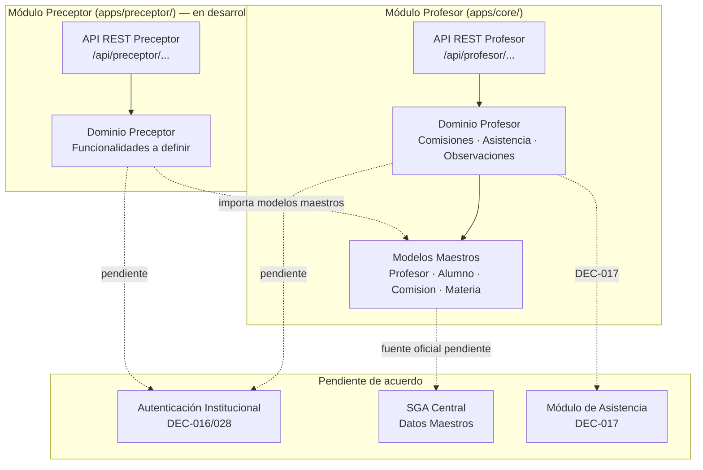

# Módulos e Integración

**Proyecto:** SGA — Sistema de Gestión Académica  
**Última actualización:** 2026-10-16  
**Documentos relacionados:** [ARCHITECTURE.md](../ARCHITECTURE.md) | [DECISIONS.md](../DECISIONS.md) | [SPEC-002](../specs/SPEC-002-modelo-dominio.md)

---

## 1. Mapa de módulos del SGA

El Sistema de Gestión Académica se compone de módulos independientes. Cada módulo es desarrollado por un integrante del equipo y tiene responsabilidades específicas:

```
┌──────────────────────────────────────────────────────────┐
│                   SGA (monolito modular)                  │
│                                                          │
│  ┌────────────────────┐    ┌────────────────────┐        │
│  │  Módulo Profesor    │    │  Módulo Preceptor   │       │
│  │  (Nicolás)          │◄──►│  (otro integrante)  │       │
│  └─────────┬──────────┘    └─────────┬──────────┘        │
│            │                         │                    │
│            ▼                         ▼                    │
│  ┌─────────────────────────────────────────────┐         │
│  │     Entidades compartidas (datos maestros)    │        │
│  │  Profesor · Alumno · Comisión · Materia       │        │
│  │  PeriodoLectivo · AsignacionDocente            │       │
│  └─────────────────────────────────────────────┘         │
│                                                          │
│  ┌────────────────────┐    ┌────────────────────┐        │
│  │  Autenticación      │    │  SGA Central        │       │
│  │  (pendiente)        │    │  (datos maestros)   │       │
│  └────────────────────┘    └────────────────────┘        │
└──────────────────────────────────────────────────────────┘
```

---

## 2. Responsabilidades por módulo

### Módulo Profesor

**Responsable:** Nicolás  
**Estado:** Dominio implementado, API REST funcional, interfaz con rediseño visual, 40 pruebas automatizadas.

| Responsabilidad | Detalle |
| :--- | :--- |
| Consultar comisiones del docente | Filtra por asignación docente y período activo |
| Consultar nómina de alumnos | Incluye alumnos activos y soporte para bajas |
| Tomar asistencia | Estados cerrados (PRESENTE/AUSENTE/TARDE), toma parcial, idempotencia |
| Registrar observaciones pedagógicas | Texto libre con doble marca temporal |
| Gestionar instancias de clase | Soporte para múltiples clases en el mismo día |

**Entidades propias** (creadas y gestionadas por este módulo):
- `InstanciaClase`
- `ObservacionAcademica`
- Lógica de validación de asistencia (`domain/attendance.py`)

### Módulo Preceptor

**Responsable:** Otro integrante del equipo  
**Estado:** En desarrollo.

> **Nota:** Las responsabilidades específicas del Módulo Preceptor deben ser definidas por su responsable. Los puntos siguientes son expectativas razonables basadas en el contexto institucional, **no compromisos confirmados**.

Funcionalidades posibles (a confirmar):
- Gestión administrativa de asistencia y partes de preceptoría.
- Seguimiento de alumnos desde la perspectiva administrativa.
- Comunicaciones institucionales.

---

## 3. Entidades compartidas

Las siguientes entidades son **datos maestros** cuya fuente oficial es el SGA Central. Ambos módulos las consumen pero **ninguno es dueño**:

| Entidad | Fuente oficial | Uso en el Módulo Profesor | ¿Modificable? |
| :--- | :--- | :--- | :--- |
| `Profesor` | SGA / IdP | Identidad del docente autenticado | ❌ Solo lectura |
| `Alumno` | SGA | Nómina de comisiones | ❌ Solo lectura |
| `Comisión` | SGA | Unidad operativa central del módulo | ❌ Solo lectura |
| `Materia` | SGA | Contexto curricular de la comisión | ❌ Solo lectura |
| `PeriodoLectivo` | SGA / Calendario | Filtro de vigencia temporal | ❌ Solo lectura |
| `AsignacionDocente` | SGA | Autorización de acceso docente | ❌ Solo lectura |
| `VinculoAlumnoComision` | SGA | Inscripción temporal de alumnos | ❌ Solo lectura |

### Regla fundamental: no duplicar datos maestros

**Cada dato maestro tiene una única fuente oficial.** Si ambos módulos necesitan datos de alumnos, los consultan al SGA (o a una réplica acordada), no los crean por separado. Esto evita inconsistencias cuando un alumno cambia de comisión o se actualiza un nombre.

El mecanismo concreto de acceso (consulta en tiempo real, réplica local, claims en token) es una **decisión institucional pendiente** (DEC-018).

---

## 4. Contratos de integración entre módulos

### 4.1. Contratos que ya existen (Módulo Profesor)

El Módulo Profesor expone los siguientes endpoints REST, que otros módulos podrían consumir si se acuerda:

| Endpoint | Método | Descripción |
| :--- | :--- | :--- |
| `/api/health/` | GET | Verificación de salud |
| `/api/profesores/` | GET | Catálogo de profesores (desarrollo) |
| `/api/profesor/comisiones/` | GET | Comisiones asignadas al docente |
| `/api/comisiones/{id}/alumnos/` | GET | Nómina de una comisión |
| `/api/comisiones/{id}/clases/` | GET/POST | Instancias de clase |
| `/api/comisiones/{id}/clases/{id}/asistencia/validar/` | POST | Validación de lote de asistencia |
| `/api/comisiones/{id}/observaciones/` | GET/POST | Observaciones académicas |

> **Importante:** Estos endpoints fueron diseñados para el Módulo Profesor. Si el Módulo Preceptor necesita consumirlos, hay que acordar previamente los contratos de autorización y el formato de respuesta.

### 4.2. Contratos que todavía deben acordarse

| Contrato pendiente | ¿Quiénes deben acordarlo? | Impacto |
| :--- | :--- | :--- |
| **Formato de identificadores compartidos** | Todos los módulos | ¿UUID, legajos numéricos, códigos institucionales? (DEC-019) |
| **Protocolo de autenticación** | Equipo + institución | ¿JWT, OAuth2, sesión compartida? (DEC-016/028) |
| **Acceso a datos maestros** | Equipo + SGA Central | ¿API en tiempo real, réplica local, token con claims? (DEC-018) |
| **Persistencia oficial de asistencia** | Equipo + módulo de asistencia | ¿Delegada o local con sincronización? (DEC-017) |
| **Visibilidad de observaciones entre docentes** | Equipo + área pedagógica | ¿Acceso compartido o restringido al autor? (R-OBS-06) |
| **Política de rectificación de asistencia** | Equipo + área académica | ¿Ventana de edición o inmutabilidad estricta? (DEC-021) |

---

## 5. Puertos de integración (arquitectura hexagonal)

El Módulo Profesor usa el patrón de **Puertos y Adaptadores** para desacoplarse de las decisiones institucionales pendientes. Los puertos están definidos en [`backend/apps/core/domain/ports.py`](../../backend/apps/core/domain/ports.py):

| Puerto (interfaz abstracta) | Responsabilidad | Estado actual |
| :--- | :--- | :--- |
| `IAuthenticationGateway` | Verificar identidad del usuario | Provisional: cabecera `X-Profesor-Id` |
| `IAcademicDataGateway` | Consultar datos maestros (comisiones, alumnos) | Implementado con adaptador local |
| `IAttendanceGateway` | Persistir/consultar asistencia oficial | Desacoplado; pendiente de DEC-017 |
| `IObservationRepository` | Persistir observaciones pedagógicas | Implementado con adaptador ORM |

**¿Qué significa esto en la práctica?**

Cuando se defina el protocolo de autenticación institucional, solo hay que crear un nuevo adaptador que implemente `IAuthenticationGateway`. La lógica de dominio y las vistas REST **no se modifican**.

---

## 6. Reglas para evitar conflictos entre módulos

### 6.1. No duplicar modelos

Si necesitás datos que ya gestiona otro módulo o el SGA Central, importalos o consumilos. No crees una tabla `Alumno` diferente en tu módulo.

**Actualmente**, el Módulo Profesor define modelos Django para las entidades maestras (como `Profesor`, `Alumno`, `Comision`) porque aún no existe la integración con el SGA Central. Estos modelos actúan como *réplicas locales de soporte* y deben tratarse como de solo lectura.

### 6.2. No duplicar lógica de negocio

La validación de asistencia está en `backend/apps/core/domain/attendance.py`. Si el Módulo Preceptor necesita validar asistencia, debe consumir esta lógica o el endpoint existente, no reimplementarla.

### 6.3. No crear entidades compartidas sin acuerdo

Si necesitás una entidad nueva que afecte a ambos módulos (por ejemplo, una tabla de `CategoriaObservacion`), proponelo al equipo antes de implementarla.

### 6.4. Identificadores consistentes

Mientras no se acuerde el formato institucional (DEC-019), usamos **UUIDv4** como identificador de entidades. No uses enteros autoincrementales para entidades que se compartan entre módulos.

---

## 7. Cómo debería integrarse el Módulo Preceptor

### Escenario recomendado

Dado que el proyecto usa un enfoque de **monolito modular**, la integración más natural es:

1. **El Módulo Preceptor se agrega como una nueva app Django** dentro del mismo proyecto `backend/`:

```
backend/
├── apps/
│   ├── core/          # Módulo Profesor (existente)
│   └── preceptor/     # Módulo Preceptor (nuevo)
```

2. **Comparte los modelos maestros** definidos en `apps/core/models.py` (importando desde allí en vez de redefinirlos).

3. **Define sus propios modelos** para entidades específicas del preceptor en `apps/preceptor/models.py`.

4. **Registra sus propias rutas** bajo un prefijo diferente (ej. `/api/preceptor/...`) en su propio `urls.py`.

### Puntos de integración a acordar

Antes de que el Módulo Preceptor acceda a datos del Módulo Profesor (o viceversa), es necesario acordar:

- [ ] ¿El preceptor puede ver las observaciones del profesor? → Depende de R-OBS-06.
- [ ] ¿El preceptor puede ver o gestionar asistencias? → Depende de DEC-017.
- [ ] ¿Comparten el mismo sistema de autenticación? → Depende de DEC-016/028.
- [ ] ¿Qué entidades nuevas crea el Módulo Preceptor?
- [ ] ¿Necesitan comunicarse entre módulos (ej. notificaciones de inasistencias)?

> **Recomendación:** Antes de integrar, que cada integrante documente las entidades que crea y los endpoints que expone. Luego se acuerdan los puntos de cruce en una reunión de equipo.

---

## 8. Diagrama de integración


