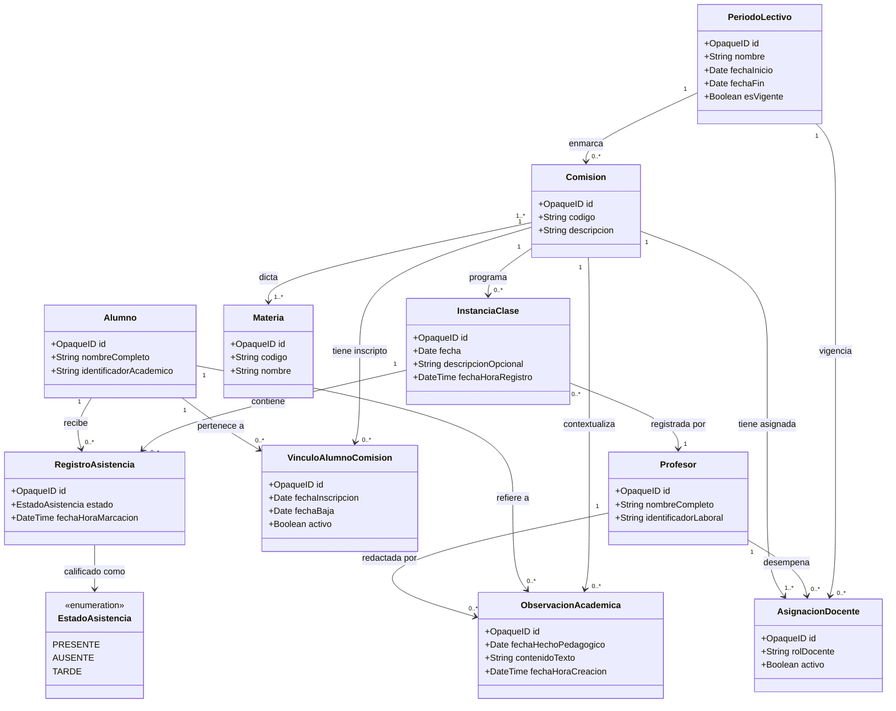

# SPEC-002 — Modelo Conceptual del Dominio y Reglas de Negocio

**Estado:** Correcciones aplicadas — Pendiente de revisión y aprobación humana (Tarea 2.2)  
**Proyecto:** Sistema de Gestión Académica — Sistema Profesor  
**Versión:** 1.1 (Conceptual)  
**Documentos de referencia:** [spec.md](file:///c:/Users/Nicolas/Desktop/tarea/spec.md) | [ARCHITECTURE.md](file:///c:/Users/Nicolas/Desktop/tarea/docs/ARCHITECTURE.md) | [DECISIONS.md](file:///c:/Users/Nicolas/Desktop/tarea/docs/DECISIONS.md)

---

## 1. Objetivo y Alcance

### 1.1. Objetivo
Definir la estructura conceptual del dominio, el lenguaje ubicuo (*Ubiquitous Language*), los límites de las entidades, sus cardinalidades y las invariantes de negocio para el **Sistema Profesor**, garantizando que el diseño responda estrictamente al alcance del MVP sin acoplarse prematuramente a esquemas de base de datos físicos, modelos de ORM ni contratos de transporte.

### 1.2. Alcance Funcional del MVP
El modelo conceptual soporta las seis capacidades del MVP definidas en `spec.md`:
1. Acceso del profesor mediante el sistema de autenticación acordado.
2. Consulta de comisiones y materias asignadas durante el período actual.
3. Consulta de alumnos de una comisión.
4. Toma de asistencia con estados `presente`, `ausente` y `tarde`.
5. Consulta del historial de asistencia de alumnos.
6. Registro de observaciones académicas por alumno, comisión y fecha.

### 1.3. Exclusiones Explícitas
Quedan fuera del modelo de dominio del MVP:
- Calificaciones numéricas, ponderaciones y escalas de notas.
- Cuadernos de comunicados y mensajería general.
- Carga y almacenamiento de archivos adjuntos.
- Gestión de matrículas, planes de estudio y administración de cupos.

---

## 2. Glosario del Dominio (Lenguaje Ubicuo)

- **Profesor / Docente:** Agente pedagógico que posee un vínculo formal de enseñanza y evaluación con una o más comisiones durante un período lectivo.
- **Alumno / Estudiante:** Persona matriculada en la institución e inscripta en una comisión académica para cursar una o más materias.
- **Materia / Espacio Curricular:** Unidad pedagógica y temática definida en el plan de estudios institucional (ej. *Matemática I*, *Práctica Profesional*).
- **Comisión:** Agrupamiento académico y organizativo específico (definido por división, turno, año y cohorte) donde confluyen alumnos, docentes y materias para el dictado efectivo de clases.
- **Asignación Docente:** Vínculo contractual o pedagógico formal que asocia a un Profesor con una Comisión (y eventualmente con una Materia específica dentro de ella) para un Período Lectivo determinado. Dato maestro gestionado por el Sistema de Gestión Académica (SGA), consumido en solo lectura por el Sistema Profesor.
- **Período Lectivo:** Intervalo temporal académico oficial (ej. primer cuatrimestre, ciclo lectivo anual) que establece el marco de vigencia de comisiones, cursadas y asignaciones. Dato maestro externo al Sistema Profesor.
- **Vínculo Alumno-Comisión:** Relación temporal que registra que un alumno estuvo inscripto en una comisión durante un período lectivo. Puede tener fecha de inicio y fecha de baja (en caso de cambio de comisión). Dato maestro del SGA; el Sistema Profesor lo consume como referencia de solo lectura.
- **Instancia de Clase:** Evento pedagógico concreto en el tiempo en el que se imparte una clase para una comisión. Se distingue formalmente de la fecha de calendario pura, permitiendo representar múltiples clases de una misma comisión en un solo día. Concepto propio del Sistema Profesor.
- **Registro de Asistencia:** Atestación del estado de presencia de un alumno en una instancia de clase. Su propiedad está pendiente de acuerdo institucional.
- **Estado de Asistencia:** Valor cerrado y tipado del dominio: `PRESENTE`, `AUSENTE` o `TARDE`.
- **Toma de Asistencia Parcial:** Estado intermedio en que se han registrado estados de asistencia para algunos alumnos de una instancia de clase, pero no para la totalidad de la nómina. No implica que los alumnos sin estado sean `AUSENTE`.
- **Observación Académica:** Registro cualitativo de texto libre elaborado por un docente. Concepto propio del Sistema Profesor. Distingue entre la fecha del hecho pedagógico observado y la fecha de creación del registro.

---

## 3. Entidades, Responsabilidades y Justificación Conceptual

| Concepto Conceptual | Tipo en el Dominio | Justificación en el Sistema Profesor | Responsabilidad Principal |
| :--- | :--- | :--- | :--- |
| **Profesor** | Referencia Externa | Representa la identidad docente autenticada. Es el sujeto sobre el que se evalúa la autorización por comisión. | Proveer la referencia de identidad del docente para filtrar comisiones autorizadas y firmar autoría de registros. |
| **Alumno** | Referencia Externa | Sujeto del proceso de enseñanza. Requiere estar individualizado para asociarle asistencias y observaciones. | Mantener la identidad académica básica (nombre, identificador) dentro del contexto de la comisión. |
| **Materia** | Referencia Externa | Provee el contexto curricular formal de la cursada. | Contextualizar la comisión en el plan de estudios institucional. |
| **Comisión** | Referencia Externa Agregadora | Unidad operativa central del MVP. Todo acceso docente, consulta de alumnos y toma de asistencia se estructura alrededor de ella. | Agrupar los vínculos con alumnos, materias y asignaciones docentes que delimitan el contexto de trabajo. |
| **Asignación Docente** | Referencia Externa de Vínculo | La relación entre Profesor y Comisión no es estática: puede haber varios docentes por comisión (titular, adjunto, suplente) con distintos roles y vigencias. | Determinar si un docente autenticado está habilitado para acceder a una comisión en el período vigente. La fuente de esta información es el SGA, accedida vía adaptador de integración. |
| **Período Lectivo** | Referencia Externa de Contexto | Requerida por la regla confirmada que prohíbe fechas fijas. Permite discernir qué comisiones corresponden a la cursada actual. | Delimitar la ventana temporal de vigencia para filtrar la actividad activa del docente. |
| **Vínculo Alumno-Comisión** | Referencia Externa con Dimensión Temporal | La inscripción de un alumno en una comisión no es permanente: puede cambiar de comisión durante el período. Representar esto como un simple atributo de `Alumno` no captura la temporalidad ni preserva el historial. | Registrar que un alumno estuvo inscripto en una comisión durante un período, con una posible fecha de baja. El Sistema Profesor no es propietario de este dato. |
| **Instancia de Clase** | Concepto Propio del Sistema Profesor | Esencial para desacoplar el evento pedagógico de la fecha de calendario y para la idempotencia de asistencia. La identidad de una instancia proviene de su identificador opaco, no de su fecha ni de su descripción textual. | Identificar la sesión específica de clase a la que se imputan los registros de asistencia. |
| **Registro de Asistencia** | Concepto Propio / Pendiente de Acuerdo | Hecho atómico de la toma de asistencia. Su propiedad definitiva depende del acuerdo institucional sobre el Escenario A o B. | Asociar un alumno con una instancia de clase y un estado. Puede existir en estado incompleto hasta que se decida si la totalidad es obligatoria. |
| **Observación Académica** | Concepto Propio del Sistema Profesor | Registro de seguimiento formativo nativo del sistema. | Almacenar comentarios cualitativos vinculados a un alumno, comisión, fecha del hecho y docente autor, con su propia marca de tiempo de creación. |

---

## 4. Relaciones y Cardinalidades

### 4.1. Diagrama Conceptual

### 4.2. Detalle de Cardinalidades y Restricciones Semánticas

**1. Período Lectivo ↔ Comisión**
- **Cardinalidad:** `1 : 0..*`
- **Participación:** Obligatoria en Comisión. No puede existir una comisión sin período lectivo asignado.
- **Clasificación:** Referencia externa. El período activo se determina mediante una regla explícita, no un valor fijo en el código (decisión confirmada DEC-007).

**2. Comisión ↔ Materia**
- **Cardinalidad:** `1..* : 1..*` (N:M)
- **Participación:** Obligatoria. Una comisión debe dictar al menos una materia.
- **Clasificación:** Referencia externa. Generalmente `1:1` en la práctica, pero modelado N:M para no invalidar casos institucionales reales.
- **Pendiente de confirmación:** ¿La institución contempla comisiones interdisciplinarias o codocentes de materias distintas?

**3. Profesor ↔ Comisión (vía Asignación Docente)**
- **Cardinalidad:** Un Profesor posee `0..*` Asignaciones; una Comisión posee `1..*` Asignaciones Docentes.
- **Significado:** Permite múltiples docentes por comisión (titular, adjunto, suplente) sin duplicar la comisión.
- **Clasificación:** Referencia externa. La fuente de este vínculo es el SGA, accedida por el Sistema Profesor mediante un adaptador de integración cuyo mecanismo concreto está pendiente de acuerdo institucional (DEC-015, DEC-018).
- **Nota sobre autorización:** La evaluación de si un docente está habilitado para acceder a una comisión requiere que el Sistema Profesor pueda consultar esta información. El mecanismo específico (consulta en tiempo real al SGA, token con claims de comisiones, réplica local) no está definido aún.

**4. Alumno ↔ Comisión (vía Vínculo Alumno-Comisión)**
- **Cardinalidad:** Un Alumno participa en `1..*` vínculos a lo largo del tiempo; una Comisión agrupa `0..*` vínculos activos.
- **Significado:** La inscripción de un alumno en una comisión tiene dimensión temporal. Un alumno puede ser dado de baja de una comisión y trasladado a otra. Este vínculo captura el período de inscripción activa y preserva el historial.
- **Clasificación:** Referencia externa. El Sistema Profesor no es propietario de las matrículas; consume la nómina vigente desde el SGA.
- **Pendiente de acuerdo:** Cómo y con qué frecuencia se actualiza la nómina en el Sistema Profesor cuando el SGA registra un alta o baja de alumno.

**5. Comisión ↔ Instancia de Clase**
- **Cardinalidad:** `1 : 0..*`
- **Participación:** Obligatoria en Instancia de Clase. Toda sesión de clase pertenece a exactamente una comisión.
- **Clasificación:** Concepto propio. La instancia de clase es generada en el Sistema Profesor durante la toma de asistencia.

**6. Instancia de Clase ↔ Registro de Asistencia ↔ Alumno**
- **Cardinalidad:** Una `InstanciaClase` agrupa `0..*` `RegistroAsistencia`; cada `RegistroAsistencia` corresponde a un único Alumno.
- **Invariante de unicidad conceptual:** Para una tupla `(InstanciaClase, Alumno)` existe como máximo un estado de asistencia vigente.
- **Nota sobre identidad:** La identidad de la `InstanciaClase` proviene de su identificador opaco, no de su fecha ni de su campo descriptivo. El campo `descripcionOpcional` es informativo y no opera como clave de idempotencia.
- **Nota sobre completitud:** El modelo no exige que todos los alumnos de la nómina tengan estado en cada toma. Un alumno sin estado asignado no es equivalente a `AUSENTE`. Ver R-ASI-02.

**7. Observación Académica ↔ (Alumno, Comisión, Profesor)**
- **Cardinalidad:** Una observación vincula exactamente `1` Alumno, `1` Comisión y `1` Profesor (autor).
- **Participación:** Obligatoria en los tres extremos. No existen observaciones anónimas ni huérfanas.
- **Nota temporal:** La observación registra dos marcas de tiempo distintas: la fecha del hecho pedagógico observado (`fechaHechoPedagogico`) y la fecha y hora de creación del registro en el sistema (`fechaHoraCreacion`).

---

## 5. Reglas de Negocio e Invariantes

### 5.1. Asignaciones Docentes y Control de Acceso

- **R-DOC-01 (Scope Docente)** — *Decisión confirmada (DEC-005)*  
  Un usuario autenticado con rol `Profesor` solo puede acceder a la información de aquellas comisiones donde exista una `AsignaciónDocente` vigente asociada a su identificador y correspondiente al `PeríodoLectivo` activo. Este control es responsabilidad del backend del Sistema Profesor; no depende de restricciones del cliente.

- **R-DOC-02 (Fuente de la Autorización)** — *Principio de diseño propuesto*  
  La verificación de si un docente está habilitado para una comisión requiere consultar la información de asignaciones que proviene del SGA. El mecanismo concreto (consulta en tiempo real, réplica local, claims en el token) es un adaptador de infraestructura cuyo contrato está pendiente de acuerdo institucional. El dominio define la regla; la infraestructura define cómo se obtiene el dato.

- **R-DOC-03 (Cese de Asignación)** — *Regla propuesta / Pendiente de política de retención*  
  Si una asignación docente se desactiva durante el período (ej. fin de suplencia), el docente pierde capacidad de registrar nuevas asistencias u observaciones en dicha comisión. El acceso al historial de lo ya registrado por ese docente depende de una política de retención que debe definirse institucionalmente.

### 5.2. Instancias de Clase

- **R-CLS-01 (Distinción Fecha vs. Instancia)** — *Principio de diseño confirmado*  
  La `InstanciaClase` representa la sesión pedagógica concreta, no la fecha del calendario. Una comisión puede tener dos o más instancias en la misma fecha (ej. bloque teórico matutino y bloque práctico vespertino). La identidad de la instancia proviene de su identificador opaco.

- **R-CLS-02 (Docente Registrador)** — *Regla propuesta*  
  Toda instancia de clase registra cuál docente inició y condujo la toma de asistencia de esa sesión. Esto no implica que sea el único docente autorizado para la comisión; establece la autoría del registro.

- **R-CLS-03 (Ciclo de Vida de la Clase)** — *Propuesta pendiente de validación institucional*  
  Se propone conceptualmente que una instancia de clase pueda encontrarse en estados como *No Registrada*, *Asentada* o *Consolidada*, pero estos estados no son confirmados por `spec.md` ni por ningún acuerdo institucional hasta la fecha.  
  En particular, el momento en que una clase pasa a ser de solo lectura definitiva para el docente depende de la política de rectificación, que está pendiente de acuerdo (ver R-ASI-04). **No se implementarán estos estados sin validación previa.**

### 5.3. Asistencia

- **R-ASI-01 (Estados Tipados Cerrados)** — *Decisión confirmada (DEC-004)*  
  Todo registro de asistencia debe adoptar uno de los tres estados definidos: `PRESENTE`, `AUSENTE` o `TARDE`. No se admiten valores nulos como estado final, estados libres ni justificaciones en el MVP.

- **R-ASI-02 (Toma Parcial de Asistencia)** — *Regla propuesta pendiente de validación institucional*  
  El MVP admite que una toma de asistencia quede parcialmente completada: pueden existir alumnos de la nómina sin estado asignado en una instancia de clase. Un alumno sin estado no se considera automáticamente `AUSENTE`; la ausencia de dato no equivale al dato de ausencia. Si la institución exige totalidad obligatoria (todos los alumnos deben tener estado antes de poder guardar), esa restricción debe confirmarse explícitamente como regla de negocio. Hasta tanto, el modelo no la impone.

- **R-ASI-03 (Idempotencia ante Reintentos Técnicos)** — *Principio de diseño propuesto*  
  El reenvío idéntico de un lote de asistencia causado por un reintento de red debe resultar en la confirmación del estado ya existente sin generar duplicados. La identidad de la operación depende de la `InstanciaClase` y del Alumno, no de campos descriptivos como la fecha ni la descripción del bloque. El mecanismo concreto de idempotencia (ej. clave de idempotencia en la petición, restricción en la capa de persistencia) se definirá al diseñar los contratos de API y los modelos físicos.

- **R-ASI-04 (Distinción entre Reintento y Rectificación)** — *Principio de diseño propuesto / Parcialmente pendiente de acuerdo*  
  El dominio distingue dos situaciones operativas distintas:
  - **Reintento técnico:** El cliente reenvía la misma lista de asistencia sin cambios, causado por una interrupción de red. El sistema debe responder idempotentemente (R-ASI-03).
  - **Rectificación intencional:** El docente deliberadamente cambia el estado de un alumno ya registrado (ej. de `AUSENTE` a `TARDE`). Este caso implica modificar un dato existente y requiere auditoría (marca de quién y cuándo modificó).  
  La posibilidad de rectificación y su ventana temporal (ej. ¿solo durante la misma sesión? ¿solo en el día?) son decisiones institucionales pendientes. El modelo conceptual no impone restricciones que no estén confirmadas.

### 5.4. Observaciones Académicas

- **R-OBS-01 (Contextualización Estricta)** — *Decisión confirmada (spec.md)*  
  Toda observación académica requiere: (1) un alumno destinatario, (2) la comisión en la que se efectúa, (3) la fecha del hecho pedagógico observado y (4) el docente autor. Los cuatro son obligatorios.

- **R-OBS-02 (Pertenencia del Alumno)** — *Regla propuesta*  
  El alumno destinatario debe tener o haber tenido un vínculo activo con la comisión referenciada. No se pueden crear observaciones sobre alumnos ajenos a la comisión.

- **R-OBS-03 (Validación de Contenido)** — *Principio de seguridad propuesto*  
  El contenido es texto libre no vacío. El sistema aplica sanitización para prevenir la inyección de scripts. No se impone longitud máxima sin una decisión de diseño del producto.

- **R-OBS-04 (Dos Marcas de Tiempo)** — *Regla propuesta*  
  La observación distingue:
  - `fechaHechoPedagogico` (Date): la fecha del evento académico que el docente está documentando. Puede ser anterior a la fecha de creación del registro (ej. el docente escribe la observación al día siguiente de la clase observada).
  - `fechaHoraCreacion` (DateTime): la marca de tiempo generada automáticamente por el sistema en el momento de persistir el registro. No es editable.  
  No se impone que ambas fechas deban coincidir, salvo que la institución establezca una restricción de retroactividad.

- **R-OBS-05 (Ámbito Pedagógico)** — *Regla propuesta*  
  Las observaciones son de naturaleza académica y formativa. No reemplazan sanciones disciplinarias ni partes de preceptoría o bedelía institucional.

- **R-OBS-06 (Visibilidad entre Docentes)** — *Pendiente de acuerdo institucional / Riesgo de privacidad identificado*  
  No se asume que todos los docentes asignados a una comisión pueden leer las observaciones de sus colegas. La visibilidad puede restringirse al autor, o extenderse a cotitulares con roles específicos. La autoría del registro es inalterable independientemente de la decisión de visibilidad.  
  > ⚠️ **Riesgo identificado:** Compartir observaciones entre cotitulares sin restricción puede generar conflictos pedagógicos o vulnerar la privacidad del alumno si la observación contiene información sensible. Se recomienda definir una política de visibilidad explícita antes de implementar esta funcionalidad.

### 5.5. Período Lectivo Vigente

- **R-PER-01 (Resolución Determinística)** — *Decisión confirmada (DEC-007)*  
  El período lectivo activo no puede estar fijo en el código. Debe resolverse mediante una regla de negocio explícita provista por el SGA o calculada a partir de un calendario académico oficial accesible. El mecanismo concreto (claim del token, endpoint del SGA, tabla configurada localmente) está pendiente de acuerdo institucional.

- **R-PER-02 (Filtro por Defecto)** — *Recomendación de experiencia de usuario*  
  Al ingresar, el profesor visualiza por defecto las comisiones del período activo. Reducir la carga cognitiva al presentar solo la información pertinente es un principio de diseño, no una regla de negocio con impacto en la integridad de los datos.

---

## 6. Separación entre Dominio Local, Referencias Externas y Propiedad de Datos

| Concepto de Dominio | Clasificación | Sistema Fuente Oficial | Consideración de Identificador y Persistencia |
| :--- | :--- | :--- | :--- |
| **Profesor** | Referencia Externa | SGA / IdP | Identificador opaco institucional. El Sistema Profesor no gestiona legajos ni altas de personal. |
| **Alumno** | Referencia Externa | SGA | Identificador opaco institucional. El Sistema Profesor no gestiona matrículas. |
| **Materia** | Referencia Externa | SGA | Código curricular opaco de referencia. Solo lectura. |
| **Comisión** | Referencia Externa | SGA | Identificador opaco institucional. Solo lectura de datos estructurales. |
| **Asignación Docente** | Referencia Externa | SGA | Vínculo maestro gestionado por la secretaría académica central. Solo lectura mediante adaptador. |
| **Vínculo Alumno-Comisión** | Referencia Externa con Dimensión Temporal | SGA | El Sistema Profesor consume la nómina vigente y su historial de cambios. No es propietario de las inscripciones. |
| **Período Lectivo** | Referencia Externa | SGA / Calendario Oficial | Rango de fechas y vigencia consumido desde el exterior. |
| **Instancia de Clase** | **Concepto Propio del Sistema Profesor** | **Sistema Profesor** | Generada localmente durante el flujo de toma de asistencia. La identidad proviene de su `OpaqueID`, no de sus campos descriptivos. |
| **Observación Académica** | **Concepto Propio del Sistema Profesor** | **Sistema Profesor** | Creada, almacenada y custodiada nativamente. Tiene doble marca temporal. |
| **Registro de Asistencia** | **Pendiente de Acuerdo Institucional** | *Módulo Central de Asistencia vs. Sistema Profesor* | Si rige el **Escenario A**, el Sistema Profesor envía los registros al módulo externo. Si rige el **Escenario B**, los persiste localmente y sincroniza. En ningún caso un alumno sin estado se convierte automáticamente en `AUSENTE`. |

> **Principio de Identificadores Opacos:** En este modelo conceptual no se exige UUID, entero autoincremental ni código de negocio específico. Las referencias a sistemas externos se tratan como identificadores opacos (`OpaqueID`), evitando acoplar la lógica de dominio al formato del SGA. El formato concreto se acordará en la etapa de contratos de integración.

---

## 7. Análisis de Escenarios Límite

| # | Escenario | Comportamiento Esperado | Estado de la Decisión |
| :--- | :--- | :--- | :--- |
| **1** | Docente consulta comisión no asignada. | Denegado por R-DOC-01 antes de delegar la consulta a cualquier capa de datos. | **Confirmado.** |
| **2** | Alumno cambia de comisión durante el período. | El `VínculoAlumnoComision` se desactiva en el SGA (o se registra su fecha de baja). El alumno deja de aparecer en la nómina activa de la comisión anterior. Sus `RegistroAsistencia` históricos en esa comisión se preservan vinculados a las `InstanciaClase` correspondientes. | **Parcialmente resuelto por diseño (VínculoAlumnoComision).** Pendiente: mecanismo y frecuencia de actualización de nómina desde el SGA. |
| **3** | Dos clases de la misma comisión en un mismo día. | Se crean dos entidades `InstanciaClase` con identificadores opacos distintos. Cada una tiene su propia lista de asistencia independiente. La fecha es coincidente pero los IDs son distintos. | **Resuelto por diseño.** |
| **4** | Reenvío de lista de asistencia tras corte de red. | El sistema reconoce el par `(InstanciaClase, Alumno)` ya registrado y confirma el estado existente sin duplicar (R-ASI-03). | **Resuelto como principio de diseño.** El mecanismo técnico de idempotencia se definirá en los contratos de API. |
| **5** | Docente intenta modificar un estado de asistencia ya guardado. | Si el sistema detecta que es una rectificación intencional (estado diferente al existente), se debe decidir institucionalmente si se permite la modificación y en qué ventana temporal. Sin esa decisión, el comportamiento por defecto es rechazar la modificación (solo lectura del historial, DEC-006). | **Pendiente de acuerdo institucional** sobre política de rectificación. |
| **6** | Dos docentes asignados a la misma comisión (Cotitularidad). | Ambos tienen acceso completo según R-DOC-01 (cada uno tiene su `AsignaciónDocente` activa). La `InstanciaClase` registra cuál docente tomó asistencia en esa sesión. | **Resuelto por diseño.** |
| **7** | Observación creada por otro docente de la comisión. | El docente actual puede ver la observación si la política de visibilidad institucional lo permite (R-OBS-06). En ningún caso puede modificarla ni eliminarla; la autoría es inalterable. | **Autoría confirmada como inalterable.** Visibilidad pendiente de definición institucional. |
| **8** | Desalineación entre datos locales y fuente oficial SGA. | El SGA tiene prioridad absoluta sobre datos maestros (alumnos, comisiones, asignaciones). El Sistema Profesor debe actualizar su información en la siguiente consulta o sincronización. Ningún dato que el Sistema Profesor no posee en propiedad puede contradecir la fuente oficial. | **Principio de diseño confirmado.** Mecanismo de sincronización pendiente de acuerdo. |

---

## 8. Decisiones Pendientes que Condicionan el Diseño Físico

Las siguientes cuestiones no bloquean el modelo conceptual pero deben resolverse antes de diseñar modelos físicos de base de datos o contratos de API:

1. **Propiedad definitiva del Registro de Asistencia:** ¿Escenario A (Módulo Central persiste el histórico oficial y el Sistema Profesor le envía registros) o Escenario B (persistencia local con sincronización al módulo central)?
2. **Política de rectificación de asistencia:** ¿Tiene el docente una ventana para corregir un estado en el mismo día, en la misma sesión, o el registro es inmutable desde que se guarda?
3. **Ciclo de vida confirmado de la Instancia de Clase:** ¿Cuáles son los estados reconocidos institucionalmente y quién puede transicionar entre ellos?
4. **Mecanismo de resolución del Período Lectivo Activo:** ¿Claim del token, endpoint del SGA o tabla configurada localmente en el Sistema Profesor?
5. **Mecanismo de acceso a las Asignaciones Docentes:** ¿Cómo obtiene el Sistema Profesor la lista de comisiones habilitadas para el docente autenticado?
6. **Mecanismo y frecuencia de actualización de la nómina de alumnos:** ¿Sincronización periódica, evento por cambio, o consulta en tiempo real al SGA?
7. **Política de visibilidad de Observaciones entre cotitulares:** ¿Acceso compartido entre todos los docentes de la comisión, o restringido al autor?
8. **Formato concreto de identificadores intersistema:** ¿UUIDs, legajos numéricos o códigos de negocio del SGA?

---

## 9. Criterios de Aceptación del Modelo Conceptual

El presente modelo se considerará aprobado cuando:
1. Las 6 funcionalidades del MVP (según `spec.md`) estén soportadas por las entidades, relaciones y reglas documentadas.
2. La distinción entre fecha de calendario e instancia de clase esté libre de ambigüedades.
3. El control de acceso docente esté formalizado mediante `AsignaciónDocente` y `PeríodoLectivo`, con la fuente del dato identificada aunque su mecanismo esté pendiente.
4. El concepto `VínculoAlumnoComision` esté aprobado como forma de representar la dimensión temporal de la inscripción sin atribuir propiedad al Sistema Profesor.
5. Las reglas propuestas (R-ASI-02, R-CLS-03, R-OBS-06) estén diferenciadas explícitamente de las decisiones confirmadas.
6. El modelo no contenga código, tipos SQL, nombres de tablas ni referencias a ORMs específicos.
7. El responsable del proyecto revise y apruebe este documento como base para iniciar la etapa de contratos de API e integración.
